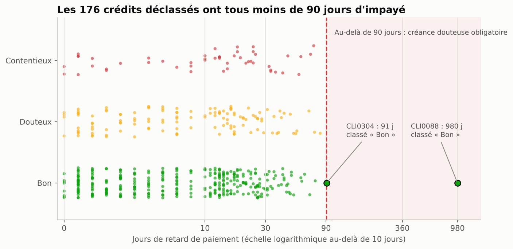
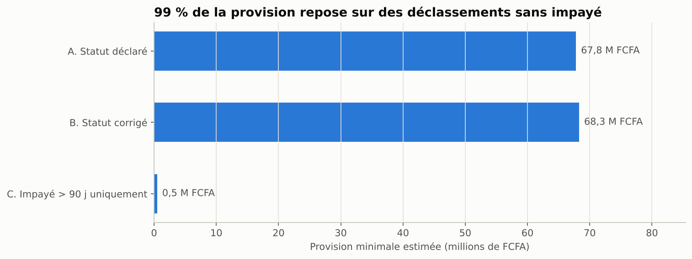
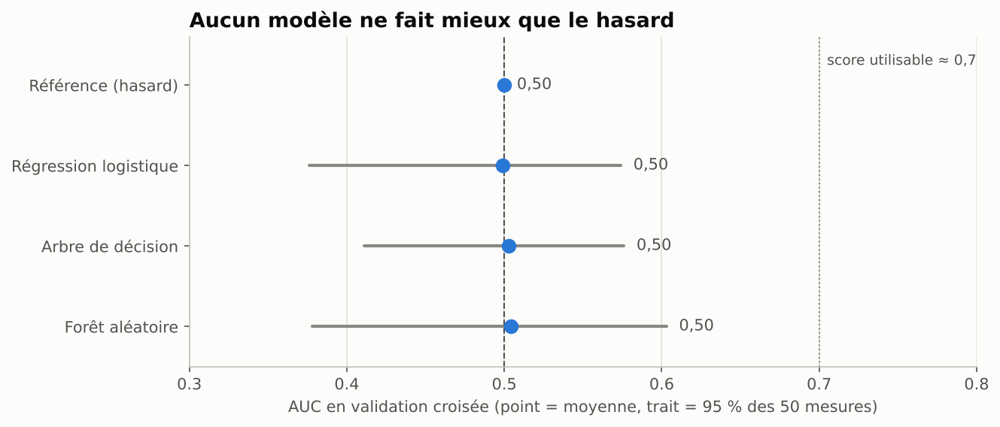

# Portefeuille de crédit BNDE · Partie 2 : fiabiliser les données, puis tester un premier score

Suite de **[TP-BNDE](https://github.com/Matar18/TP-BNDE)** (partie 1 : exploration, nettoyage et profilage de 500 crédits d'une banque de développement sénégalaise).

La partie 1 se terminait sur une question : **face à ce portefeuille, faut-il commencer par fiabiliser les données ou par construire un premier score ?**
Ce projet fait les deux, dans cet ordre, et laisse les résultats répondre.

## Résultats clés

**1. Le statut de défaut ne suit pas l'impayé.**
Selon la BCEAO, un crédit avec plus de 90 jours d'impayé doit être classé douteux. Or les **176 crédits Douteux ou Contentieux ont tous moins de 90 jours d'impayé**, et **2 crédits restent « Bon » au-delà de 90 jours** (dont un à 980 jours).



**2. Un tiers des crédits dépasse le taux d'usure.** 156 crédits ont un taux nominal supérieur à 15 %, le taux d'usure bancaire de l'UMOA jusqu'en mai 2026 (14 % depuis juin 2026).

**3. Le montant accordé ne dépend pas du revenu.** La corrélation est nulle (−0,03), et 40 clients ont une mensualité supérieure à leur revenu.

**4. 99 % de la provision minimale repose sur des déclassements sans impayé.** Corriger les 2 crédits mal classés ajoute environ 0,5 M FCFA de provision. Mais 67,8 M FCFA sur 68,3 M dépendent de déclassements que les données n'expliquent pas.



**5. Aucun modèle de score ne fait mieux que le hasard.** Régression logistique, arbre de décision et forêt aléatoire obtiennent tous une **AUC de 0,50** (Gini nul). Le test de permutation donne une p-value de 0,52. Sur une cible simulée, la même méthode retrouve pourtant un signal (AUC ≈ 0,7) : **c'est la donnée qui est en cause, pas le modèle.**



**Conclusion :** sur ce portefeuille, il faut **fiabiliser avant de scorer**. Le notebook 2 liste les données à collecter pour construire un vrai score.

## Démarche

| Notebook | Contenu |
|---|---|
| [`01_fiabilisation_donnees.ipynb`](notebooks/01_fiabilisation_donnees.ipynb) | 12 contrôles automatiques, 3 zooms (statut / impayé, taux d'usure, endettement), impact sur le provisionnement, export du portefeuille fiabilisé |
| [`02_premier_score.ipynb`](notebooks/02_premier_score.ipynb) | Cible et périmètre, exclusion du retard (fuite de données), 3 modèles contre une référence, validation croisée répétée, test de permutation, contrôle positif |

### Les 12 contrôles

| Code | Contrôle | Gravité | Crédits |
|---|---|---|---|
| R01 | Revenu négatif ou nul | Critique | 5 |
| R02 | Statut « Bon » avec impayé > 90 jours (art. 8, Instruction BCEAO 026-11-2016) | Critique | 2 |
| R03 | Montant de crédit extrême | Élevée | 1 |
| R04 | Taux > taux d'usure bancaire (15 %) | Élevée | 156 |
| R05 | Mensualité supérieure au revenu | Élevée | 40 |
| R06 | Revenu extrême | Modérée | 1 |
| R07 | Taux d'endettement entre 33 % et 100 % | Modérée | 139 |
| R08 | Déclassé sans impayé > 90 jours (art. 8-1° et 9 : à justifier) | Modérée | 176 |
| R09 | Revenu manquant | Information | 20 |
| R10 | Taux d'intérêt manquant | Information | 10 |
| R11 | Garantie non renseignée | Information | 48 |
| R12 | Âge manquant | Information | 15 |

Les règles sont codées une seule fois dans [`src/controles.py`](src/controles.py) et se rejouent sur n'importe quel portefeuille ayant les mêmes colonnes.

## Structure du dépôt

```
BNDE-Fiabilisation-Scoring/
├── data/dataset_BNDE.csv            # données brutes (identiques à la partie 1)
├── notebooks/
│   ├── 01_fiabilisation_donnees.ipynb
│   └── 02_premier_score.ipynb
├── src/
│   ├── chargement.py                # lecture, doublons, format du taux
│   ├── controles.py                 # les 12 règles, statut réglementaire, portefeuille fiabilisé
│   ├── provisions.py                # provision minimale BCEAO (art. 16) et scénarios
│   ├── features.py                  # mensualité, taux d'endettement
│   └── graphiques.py                # style commun des graphiques
├── tests/test_controles.py          # 12 tests unitaires (pytest)
├── outputs/                         # CSV prêts pour Excel (séparateur ;)
│   ├── portefeuille_fiabilise.csv   # 500 crédits + statut corrigé + une colonne par contrôle
│   ├── rapport_anomalies.csv        # 1 ligne par anomalie, avec référence et action recommandée
│   ├── synthese_controles.csv
│   ├── provisions_scenarios.csv
│   └── resultats_modeles.csv
└── figures/                         # 8 graphiques
```

## Hypothèses et limites

- **Données pédagogiques** : 500 crédits, sans date d'octroi, sans encours restant dû, sans motif de déclassement.
- **Provisions** : l'exposition est le montant initial (un majorant de l'encours). Seule la garantie immobilière est jugée éligible (hypothèque de 1er rang supposée). Un crédit déclassé sans impayé est supposé déclassé aujourd'hui, ce qui donne une provision plancher. Une analyse de sensibilité est fournie (de 7 à 130 M FCFA selon les garanties retenues).
- **Taux d'usure** : appliqué au taux nominal faute de TEG. Le TEG étant toujours supérieur ou égal au taux nominal, un dépassement du nominal implique un dépassement du TEG.
- **Seuil d'endettement de 33 %** : pratique bancaire courante, utilisée comme hypothèse de travail. Ce n'est pas une règle BCEAO.

## Références

- [Instruction BCEAO n°026-11-2016 relative à la comptabilisation et à l'évaluation des engagements en souffrance](https://www.cb-umoa.org/sites/default/files/2022-01/INSTRUCTION%20N%C2%B0026-11-2016%20RELATIVE%20A%20LA%20COMPTABILISATION%20ET%20A%20L%27EVALUATION%20DES%20ENGAGEMENTS%20EN%20SOUFFRANCE.pdf) (art. 4, 8, 9, 16)
- [Taux d'usure UMOA : 14 % pour les banques à partir du 1er juin 2026](https://www.droitmediasfinance.com/index.php/actualites/droit-bancaire/1248-uemoa-credits-bancaires-le-taux-dusure-pour-les-banques-a-14-et-pour-les-etablissements-financiers-a-24-pour-a-partir-1er-juin-20266) (décision n°19 du Conseil des Ministres de l'UMOA du 29/12/2025 ; 15 % auparavant)

## Exécution

```bash
git clone https://github.com/Matar18/BNDE-Fiabilisation-Scoring.git
cd BNDE-Fiabilisation-Scoring
pip install -r requirements.txt
python -m pytest -q                 # 12 tests
jupyter notebook notebooks/
```

## Outils

Python (pandas, NumPy, SciPy, scikit-learn, Matplotlib), Jupyter, pytest.

## Auteur

Matar Ndoye
